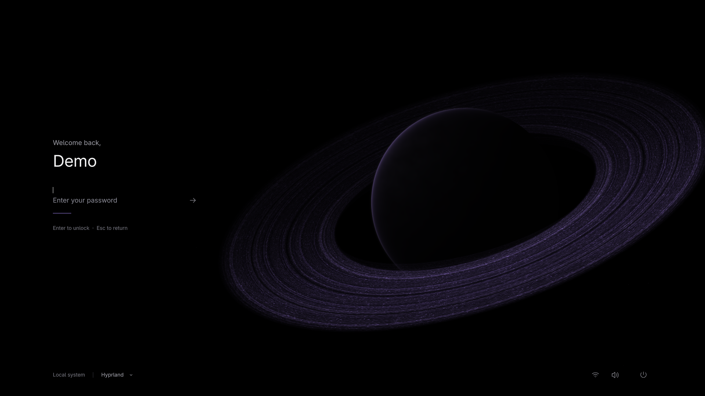

# Nocturne Greeter — Umbra 0.9

Português (Brasil) · [English](README.en.md)

Greeter para sessões Wayland, construído com **Quickshell, QML e GLSL** e integrado ao **greetd + PAM**. A interface combina um corpo obsidiano, matéria orbital animada e uma tela de autenticação minimalista.

**Pronto para uso no Arch Linux.** A versão `0.9.0-2` está instalada e em uso no sistema do autor, após validação de login real, sessões, energia e boot em uma VM descartável.



*Interface atual, capturada em 1920×1080 pelo modo preview com uma identidade de demonstração.*

## Recursos

- Autenticação real pelo greetd e pelo PAM da distribuição, com mensagens de erro e de bloqueio da conta.
- Seleção de usuários locais e de sessões Wayland instaladas, com memória da última escolha.
- Catálogo de sessões gerado a partir de `/usr/share/wayland-sessions`, incluindo Hyprland, Hyprland via uwsm e Plasma Wayland quando instalados.
- Suspender, reiniciar e desligar pela tela de login.
- Transição animada para a sessão, liberada somente após a apresentação do quadro preto pelo compositor.
- Layout responsivo, navegação por teclado, relógio e shader orbital.
- Pacote Arch Linux com módulo de apresentação, configuração do greetd e hooks do pacman.
- Preview na sessão atual e harness Wayland isolado para desenvolvimento.

## Instalação no Arch Linux

Clone o repositório e compile o pacote local:

```sh
git clone --branch feat/real-login-vm https://github.com/gustavomfg/nocturne-greeter.git
cd nocturne-greeter/packaging/arch
makepkg -sif
```

O `makepkg` instala as dependências declaradas no [PKGBUILD](packaging/arch/PKGBUILD), incluindo greetd, Cage, Quickshell, Qt 6 e fontes. A compilação requer o grupo `base-devel`. O módulo `Nocturne.Presentation` é compilado contra o Qt instalado.

O pacote instala a interface em `/usr/share/nocturne-greeter` e configura o serviço greetd para usar `/etc/nocturne-greeter/greetd.toml`. **A instalação não habilita nem inicia o greetd automaticamente.**

Antes de trocar o gerenciador de login, salve seu trabalho e abra uma TTY com `Ctrl+Alt+F3`. O roteiro de [instalação, ativação e recuperação](docs/INSTALL_0.9.md#item-5-runbook--install-on-this-workstation) mostra como testar o greeter e torná-lo o login padrão; o exemplo usa `plasmalogin`, que deve ser substituído pelo serviço do seu gerenciador atual quando necessário.

### Manutenção e diagnóstico

Após atualizar Qt ou Quickshell, o hook do pacote verifica se o módulo de apresentação ainda carrega. Se houver incompatibilidade, recompile e reinstale:

```sh
cd packaging/arch   # a partir da raiz do clone
makepkg -sif
```

Para verificar a instalação e consultar os logs:

```sh
/usr/lib/nocturne-greeter/nocturne-greeter-check
journalctl -b -u greetd
journalctl -b -t nocturne-greeter
journalctl -b -t nocturne-session
```

O catálogo de sessões é atualizado por um hook do pacman. Para regenerá-lo manualmente após alterar um arquivo de sessão:

```sh
sudo /usr/lib/nocturne-greeter/nocturne-greeter-sessions
```

## Uso

- Clique no fundo ou pressione uma tecla para abrir a autenticação. `Espaço` apenas desperta a interface; outras teclas imprimíveis já iniciam a digitação.
- Escolha o usuário no menu disponível em repouso e a sessão no menu da barra inferior.
- Digite a senha e pressione `Enter` ou clique na seta para entrar.
- `Esc` fecha um menu aberto ou retorna ao repouso e limpa a senha.
- O menu de energia oferece suspender, reiniciar e desligar.

A interface está em inglês; a data segue o locale do Qt. As fontes usadas são **Noto Sans Light**, **Adwaita Sans** e, no debug, **Adwaita Mono**.

## Preview

Para conhecer a interface sem sair da sessão atual, execute a partir da raiz do clone:

```sh
./scripts/run-preview.sh
```

Abre em tela cheia no monitor primário. `Ctrl+Q` ou `Alt+F4` encerra. Para abrir em uma janela:

```sh
NOCTURNE_WINDOWED=1 NOCTURNE_WIDTH=1280 NOCTURNE_HEIGHT=720 ./scripts/run-preview.sh
```

No preview, `Enter` simula uma falha e `Ctrl+Enter` simula o sucesso visual. Os controles de energia ficam desabilitados e os indicadores de rede, áudio e bateria são somente leitura. Use texto de teste no campo de senha: esse modo não autentica nem inicia sessões.

`NOCTURNE_DEBUG=1` revela os controles de desenvolvimento; `NOCTURNE_USER_NAME` altera o nome exibido. Em compositores com tiling, o layout do compositor pode substituir o tamanho solicitado.

## Desenvolvimento e verificação

Os comandos abaixo partem da raiz do clone:

```sh
./scripts/build-shader.sh
./scripts/build-presentation-probe.sh
./scripts/test-greeter.sh
./scripts/lint-qml.sh
./scripts/test-greetd-adapter.sh
./scripts/test-greetd-protocol.sh
./scripts/test-launch-gate-e2e.sh
./scripts/test-launch-gate-e2e.sh --no-probe
./scripts/test-real-login-vm-guard.sh
python3 -I -m unittest discover -s tests -p 'test_sessions_catalog.py'
```

Os testes cobrem estados da interface, teclado e foco, catálogo de usuários e sessões, integração com o protocolo greetd e bloqueio do lançamento sem o módulo de apresentação. Os testes de protocolo e de lançamento usam KWin Wayland aninhado e um socket fixture, sem autenticar usuários reais.

### Harness isolado

```sh
./scripts/run-isolated-greeter.sh
./scripts/run-isolated-greeter.sh --mock-success
./scripts/run-isolated-greeter.sh --no-session-bus --duration 10
```

O harness abre um KWin Wayland aninhado, com runtime, socket e D-Bus próprios e backend mock. `Ctrl+C` no terminal encerra; os logs ficam em `logs/isolated-greeter/`.

### Capturas

```sh
./scripts/capture-preview.sh
```

Gera imagens de estados da interface em `docs/screenshots/final/`, nas dimensões 1280×720, 1920×1080, 2560×1440 e 3440×1440. Cada estado usa um processo de preview separado. As imagens são renderizadas em canvases Qt; isso não altera a resolução do monitor nem equivale a testar quatro monitores físicos.

## Arquitetura

| Caminho | Papel |
| --- | --- |
| `greeter/shell.qml` | Entrada de produção para greetd |
| `shell.qml` | Entrada do preview na sessão atual |
| `components/GreeterWindow.qml` | Composição responsiva, foco e integração visual |
| `components/GreeterController.qml` | Estados de repouso, autenticação, sucesso e falha |
| `components/GreetdAuthenticator.qml`, `AuthenticatorBridge.qml` | Autenticação, prompts PAM e cancelamento |
| `components/GreeterCatalog.qml`, `greeter-model.js` | Usuários, sessões e última escolha |
| `components/SessionLaunchPolicy.qml`, `SessionLaunchGate.qml` | Política administrativa e liberação do lançamento |
| `presentation/` | Módulo C++ que confirma a apresentação do quadro preto via `wp_presentation` |
| `shaders/`, `assets/` | Shader orbital, marca e ícones |
| `system/`, `packaging/arch/` | Catálogo de sessões, configuração, hooks e pacote |
| `harness/`, `tests/`, `vm/` | Mocks, testes e ferramentas da VM descartável |

O greeter lê um catálogo escrito por root em `/var/lib/nocturne-greeter/sessions.json`; os comandos de sessão não vêm do campo de autenticação. O lançamento ocorre uma única vez, após a confirmação da apresentação do quadro preto. Sem o módulo de apresentação, ou se essa confirmação falhar, o lançamento fica bloqueado.

## Compatibilidade e documentação

O alvo atual é **Arch Linux x86_64 com sessões Wayland**. O uso no sistema do autor complementa os testes em VM; a compatibilidade com outras distribuições, GPUs e configurações de múltiplos monitores depende de validação específica. Sessões X11 de `/usr/share/xsessions` não são oferecidas.

- [Instalação, manutenção e resultados da versão 0.9](docs/INSTALL_0.9.md)
- [Validação de login real e boot em VM — 0.8](docs/REAL_LOGIN_VM_0.8.md)
- [Integração com o protocolo greetd — 0.7](docs/GREETD_PROTOCOL_0.7.md)
- [Harness Wayland isolado — 0.6](docs/ISOLATED_GREETER_HARNESS_0.6.md)
- [Arquitetura de autenticação e lançamento — 0.5](docs/REAL_LOGIN_ARCHITECTURE_0.5.md)
- [Sistema visual](DESIGN.md), [revisão visual](docs/ART_DIRECTION_REVIEW.md) e [referências](docs/REFERENCE_NOTES.md)

Os relatórios numerados preservam o contexto de cada etapa do desenvolvimento. Para recuperar versões anteriores, use o histórico Git; os snapshots locais em `backups/` não são distribuídos.
