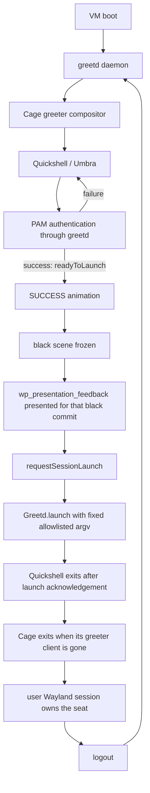

# Nocturne Greeter 0.8 — Real Login Integration in VM

**STATUS: PROVEN IN A DISPOSABLE VM** (real greetd + PAM + session launch)

**Last checked:** 2026-10-16

**Scope:** a disposable Arch Linux QEMU/KVM guest on the workstation, created
and driven without host privileges. The host's display manager, PAM, boot,
TTY, seat and login services were not touched. Nothing in this phase proves
behavior on the host's physical GPU, monitors or PLM.

## Results (2026-10-16)

### Guest and inventory

| Item | Value |
| --- | --- |
| Hypervisor | `qemu-system-x86_64` 11.1.2 (Arch `qemu-system-x86`, minimal build: no UI, no virtio-gpu/virgl modules), KVM, q35, SeaBIOS, 4 vCPU, 6 GiB, 40 GiB qcow2 |
| Display | `bochs-display` 1280×720 → guest `bochs-drm` KMS. No GL: Cage uses pixman; Qt Quick renders through Mesa llvmpipe |
| Guest | Arch Linux cloud image 20261015.611680 (SHA-256 verified), kernel 7.2.10-arch1-1, systemd 262, PAM 1.7.3 |
| Packages | greetd 0.10.3-2, greetd-agreety 0.10.3-2, cage 0.3.1-1, quickshell 0.3.2-1, qt6-base 6.12.0-3, qt6-wayland 6.12.0-1, mesa 26.2.4, foot 1.28.0-2 |
| PAM | packaged `/etc/pam.d/greetd` unchanged, SHA-256 `993a3096c2b113e6800f2abbd5d4233ebf1a97eef423990d3187d665d3490b92`. Lockout: default `pam_faillock` (deny=3, unlock_time=600) |
| greeter identity | `greeter` uid/gid 967, groups `greeter,video` (distribution sysusers). greetd socket `/run/greetd-<pid>.sock` owned by `greeter` |
| Installed tree | `/usr/share/nocturne-greeter` and `/usr/lib/qt6/qml/Nocturne/Presentation`, root:root, dirs 0755, files 0644, SHA256SUMS verified |
| Management | QMP (screen, keyboard, pointer, NIC link, snapshots) and the QEMU guest agent over virtio-serial. No SSH, no inbound forwarding, no host folder. NIC disconnected after package install |
| Snapshots | `baseline-no-greetd`, `pre-umbra`, `umbra-login-proven`, `pre-boot-enable`, `boot-proven` (internal qcow2) |

The guard (`scripts/real-login-vm-guard.py`) refused `--check` in the guest
before the marker existed, bootstrapped the root-owned marker, and then passed.
Every guest-changing script (`stage-vm-greeter.sh`) calls `--check` first.

### Proof matrix

| Case | Result |
| --- | --- |
| Recovery console before greetd | **PASS.** VT3 getty reachable with Ctrl+Alt+F3; console login and logout of the disposable user |
| agreety: empty, incorrect, repeated incorrect | **PASS.** Each returns a usable `login:` prompt; no loop. The third failure triggered the distribution `pam_faillock` lock (recorded; reset with `faillock --reset` from root) |
| agreety: correct password, logout | **PASS.** PAM session on tty2; `exit` returns to a fresh agreety greeter session |
| Cage seat probe as `greeter` | **PASS.** Cage + foot via greetd; keyboard and pointer input; VT2 → VT3 → VT2 |
| Umbra pre-login: focus, typing, Backspace, Enter, mouse wake | **PASS.** Masked dots; Backspace removes dots; Enter submits; click wakes without seeding the field |
| Umbra: incorrect and empty password | **PASS.** PAM `AUTH_ERR`; FAILURE then a new greetd attempt with the real PAM prompt (`Password:`) |
| Umbra: correct password → SUCCESS → black → launch | **PASS (real).** Journal order `success-finished → black-commit-armed → black-commit-presented → launch-requested`; presented ≈ 40 ms after arming; user session opened ≈ 120 ms after the request |
| Escape during prompt | **PASS.** Attempt cancelled (`conversation failed`), greeter exits by design, packaged `greetd.service` (`Restart=always`) starts a fresh greeter in ≈ 1 s |
| Late callback after cancel | **SIMULATED** (fixture + QML tests), as planned |
| Multiple PAM challenges | **NOT APPLICABLE.** Packaged PAM returns one challenge; PAM was not changed. Fixture covers it |
| Three login → Wayland session → logout cycles | **PASS.** After each logout only greeter Cage/Quickshell remain; after each login only the user's cage/foot/sh |
| Two reboots through greetd boot path | **PASS.** ≈ 7 s to Umbra; login/logout after each boot; plus a third boot with the final tree (6.5 s) |
| Canary scan | **PASS.** The test password never appeared in the journal, `/var/log`, `/tmp`, `/run/user`, `/var/cache`, `/var/lib/greetd` or `/home`. A positive control proved the scanner detects it |

### Failure injection

| Fault | greetd | Compositor / greeter | Loop | Recovery |
| --- | --- | --- | --- | --- |
| Broken `shell.qml` | restarts 5× then `start-limit-hit` (systemd `StartLimitBurst=5/30s`) | Quickshell exits on load, Cage exits | bounded by systemd | VT3; restore file (SHA256SUMS), `reset-failed`, start. No snapshot needed |
| Missing `pulse.frag.qsb` | unaffected | Umbra degrades: no planet, UI and login still work (`Failed to find shader`) | none | restore file |
| Quickshell SIGSEGV | unaffected | Quickshell's crash handler relaunches the config inside the same Cage; login works. Session start is delayed ≈ 5 s because the crash helper keeps the greeter Cage alive; the crash reporter cannot write to `//.cache` (greeter home is `/`) | none | automatic |
| Cage SIGTERM | restarts once | fresh Cage + Umbra | none | automatic |
| Session exits immediately (`/usr/bin/true` policy) | not restarted | session opened/closed in 0.24 s; Umbra returns in ≈ 1 s | none (needs a new login) | automatic |
| `systemctl restart greetd` while typing | restarted | old greeter gone, fresh Umbra, no orphan Cage | none | automatic |
| Incorrect credentials | — | FAILURE, retry prompt | faillock after 3 | `faillock --reset` or wait 600 s |

### Fixes made because of the VM run

- **Greeter stderr on the VT.** greetd gives the greeter its VT as stdio, so
  Cage/Quickshell logs were printed on tty after the greeter exited. The VM
  config now wraps the command in `systemd-cat --identifier=nocturne-greeter`.
- **Cancel lifecycle.** The fresh-process lifecycle depends on the packaged
  unit's `Restart=always`; the VM uses a drop-in that only changes the config
  path. A transient unit without restart leaves no greeter.
- **Recovery from the test session.** `cage` without `-s` blocks VT switching
  inside the user session. The VM policy argv is now
  `[/usr/bin/cage, -s, --, /usr/bin/foot, -e, /usr/bin/sh]`; VT3 round trip
  from the session was verified.
- **Session chip** shows the policy label instead of "Local session".

### Limits that remain

- The VM has no GPU acceleration. Quickshell used ≈ 1.7 cores (llvmpipe) in
  idle and AUTH; Cage ≈ 4 %; RSS: Quickshell ≈ 290 MB, Cage ≈ 49 MB, greetd
  ≈ 4 + 13 MB. These are VM regression numbers, not host predictions; a
  software-rendered machine would need a reduced-motion fallback.
- A printable key used to wake Umbra becomes the first character of the
  response (existing 0.4 behavior). Mouse wake does not.
- The PAM prompt text (`Password:`) replaces the default "Enter your
  password" label after the first attempt.
- Optional step 10 (Hyprland/UWSM) was not run.
- No physical seat, NVIDIA GPU, multi-monitor layout or host PLM was tested.
  Production packaging, user/session models and power actions remain future
  work.

### Reproduce

```sh
./vm/nocturne-vm.py --help                    # QMP/QGA control, no host privileges
./vm/nocturne-vm.py start --loadvm boot-proven
./vm/nocturne-vm.py wait-agent
# inside the guest (via the agent): scripts/stage-vm-greeter.sh --confirm-real-login-vm
./vm/nocturne-vm.py stop
```

The VM directory (`~/.local/share/nocturne-greeter-vm`) holds the disk,
snapshots, evidence screenshots and the 0600 test-user secret file; none of it
is in the repository.

## Recommended VM

Use a clean **Arch Linux x86-64** guest. This matches the existing CachyOS/Arch
Quickshell stack and current 0.7 API version. The Arch package database
currently lists `greetd 0.10.3-2`, `cage 0.3.1-1`, and `quickshell 0.3.1-1`;
recheck and record installed versions inside the guest immediately before the
experiment because Arch is rolling.

| Setting | Recommendation |
| --- | --- |
| Hypervisor | QEMU/KVM with hardware acceleration. No usable QEMU executable was found on the host during this preparation. |
| Guest OS | Minimal Arch Linux x86-64 install; no host dotfiles or copied desktop configuration. |
| CPU / RAM | 4 vCPU, 6 GiB RAM (8 GiB if available). |
| Disk | 40 GiB dynamically allocated qcow2 image; keep the VM and snapshots outside the Git repository. |
| Firmware | UEFI/OVMF; keep NVRAM state with the VM so boot tests are repeatable. |
| Virtual GPU | Virtio-GPU with virgl/3D enabled when the hypervisor supports it; one 1280×720 output first. Record Qt Quick renderer warnings. |
| Console / recovery | Keep the hypervisor's graphical and serial console available. Reserve a second guest TTY (for example VT3) and prove switching before testing greetd. |
| Network | NAT only while installing/updating packages. No inbound forwarding, host folder mounts, host user binding, or host credential forwarding. Disconnect the guest NIC for authentication/session tests after packages are installed. |
| Snapshots | Save a clean baseline before greetd; save again after standalone greetd/PAM proof; save immediately before changing the guest boot target. Preserve a known-good console recovery snapshot. |
| Test identity | Create one disposable guest user with a temporary local name. Set a unique random password interactively inside the guest; never reuse a host credential or write it to shell history, the repository, screenshots, or logs. |

The currently installed `systemd-vmspawn` supports qcow2 images, KVM, CPU/RAM
settings, ephemeral runs, UEFI selection and guest consoles, but it is not
usable here without a QEMU backend. If the eventual VM frontend cannot provide
virgl, keep the VM and still run the login/recovery tests; record the renderer
limitation rather than treating the guest as an RTX benchmark.

## VM guard

`scripts/real-login-vm-guard.py` accepts only a KVM/QEMU guest with all of these
signals:

1. `systemd-detect-virt --vm` returns `kvm` or `qemu`.
2. DMI vendor/product identifies QEMU.
3. `/proc/cpuinfo` exposes the `hypervisor` CPU flag.
4. A root-owned, non-symlink marker exists at
   `/etc/nocturne-greeter/real-login-vm-0.8` and contains the exact phase marker.
5. The operator supplies `--confirm-real-login-vm`.

The only write mode in the guard bootstraps that marker. It checks the first
three VM signals and explicit confirmation before checking root privileges or
writing anything. On the current host the identity checks fail, so marker
creation cannot proceed. The only guest installer, `scripts/stage-vm-greeter.sh`,
runs `--check` before its first write.

After a VM has been provisioned, boot it to its own console, verify that it is
the intended disposable guest, copy/clone the project **inside the guest**
(do not bind the host checkout), and run there:

```sh
sudo ./scripts/real-login-vm-guard.py --bootstrap --confirm-real-login-vm
./scripts/real-login-vm-guard.py --check --confirm-real-login-vm
```

Any future script that changes the guest's greetd, PAM, systemd, boot, TTY or
seat must call the `--check` operation before its first write and require the
same explicit confirmation. Failed checks must abort without falling back to
the host. `--bootstrap --dry-run --confirm-real-login-vm` checks guest identity
without writing the marker.

The guard's unit tests use synthetic QEMU/physical-host evidence. They do not
pretend that a test fixture is a VM and do not perform a privileged action.

## Compositor decision

**Initial candidate: Cage.** Umbra needs one fullscreen Wayland client at
pre-login. Cage is a kiosk compositor designed to display one maximized
application, accepts an application command, supports keyboard/pointer input,
and has a KMS/DRM path when run on a TTY. That makes it a smaller first seat
test than launching a complete desktop compositor. Cage supports multiple
outputs but does not provide output-layout configuration; begin with one
output, then explicitly test its multi-output behavior.

| Candidate | Use in this phase |
| --- | --- |
| Cage | First candidate to evaluate, not a final decision. It is a small single-app compositor; its current upstream release supports `wp_presentation`, which is useful for the black-frame gate. DRM/seat, Quickshell, keyboard layout, fullscreen and recovery still require direct proof. |
| KWin | Strong Qt compatibility and already used by the host's existing greeter, but large and dependency-heavy. Keep it as a diagnostic fallback if Cage exposes a Qt Wayland issue. KWin nested remains only a harness. |
| Weston | Stable reference compositor with useful diagnostics; more general configuration than needed for the first kiosk proof. Useful fallback if seat/backend diagnosis is needed. |
| Hyprland | Do not start with it. It adds session/configuration complexity and makes it harder to isolate the greeter lifecycle. Test a minimal Hyprland/UWSM session only after the small Wayland session loops correctly. |

Potential guest command, to be tested and adjusted only inside the VM:

```toml
[default_session]
command = "cage -s -- /usr/bin/quickshell --path /usr/share/nocturne-greeter"
user = "greeter"
```

Treat this as a plan, not an installed configuration. Check Cage's installed
manual, the packaged greeter account, seat access, `GREETD_SOCK`, environment,
socket permissions and actual fullscreen output before changing the guest's
boot behavior. Do not add `greeter` to broad groups as a workaround; grant only
the access proven necessary through the seat/session provider.

## Staged files and ownership

The 0.7 `production-root/` is a local staging tree, not an installed package.
In the guest, install the verified QML, SVG and QSB files under
`/usr/share/nocturne-greeter` with root ownership and read-only permissions for
the greeter. Do not use a developer's or test user's home/config as an asset
source. Quickshell, Cage and the Umbra frontend must run as the
unprivileged `greeter` service identity. The greetd daemon and PAM helpers are
owned by the distribution's service configuration; record their actual UID,
group, executable, unit, restart policy and socket owner/mode from the guest.

Use the distribution's packaged `/etc/pam.d/greetd` unchanged for the first
real authentication proof. Record its path and checksum in the VM report, but
do not commit host-specific PAM contents. Do not add MFA, fingerprint, keyring
or other PAM modules during the first test.

## Staged execution plan

Keep checkpoints separate so a failure has a known recovery point.

1. **Guest baseline:** install minimal Arch, create a VM-only user with an
   exclusive password, prove graphical and serial/TTY console access, save
   snapshot `baseline-no-greetd`.
2. **Inventory:** record Arch release, kernel, Qt, Quickshell, greetd, Cage,
   PAM, unit files, greetd service user/group, PAM service, socket path and
   permissions. Keep PLM and personal sessions out of this guest.
3. **greetd by itself:** use the packaged text greeter (`agreety`) on a guest
   TTY. Start it manually from the guest console before enabling it at boot.
   Check correct password, incorrect password, blank input, retry and logout
   using only the disposable user. Confirm return to the text greeter.
4. **Seat/compositor probe:** start Cage from a guest TTY as the packaged
   greeter identity with a trivial Wayland client. Prove keyboard, pointer,
   VT switching and console recovery before connecting Umbra.
5. **Umbra pre-login:** install the root-owned staging tree; configure greetd
   to run Cage + Quickshell as `greeter`; keep packaged PAM and session defaults.
   Prove focus, first key, visible/secret prompt mode, Backspace, Enter, Escape,
   mouse submit, incorrect-password FAILURE, retry and correct-password
   SUCCESS. Use a fresh guest-only canary and do not record its value.
6. **Session launch:** allow only one fixed test command in the VM build:
   `[/usr/bin/cage, -s, --, /usr/bin/foot, -e, /usr/bin/sh]`. This creates a real
   user Wayland compositor (`cage`) and terminal client (`foot`) without
   importing personal desktop files or evaluating a user-provided shell
   string. Type `exit` to log out. Do not offer general session selection in
   the first test.
7. **Cycles:** run at least three complete login → Wayland session → logout →
   Umbra cycles. Check process lists between cycles and ensure no old Cage,
   Quickshell or test-session processes remain.
8. **Failure injection:** snapshot first, then test a bad QML copy, absent QSB,
   Quickshell startup failure, compositor exit, an immediately exiting test
   session, greetd restart and incorrect credentials. Keep the recovery
   console open; record whether greetd restarts, whether a loop occurs, what
   the logs say and whether recovery needs the snapshot.
9. **Boot proof:** only after the manual loop succeeds, save a snapshot and
   enable the guest's greetd boot path. Reboot twice through Umbra → PAM →
   session and confirm recovery TTY remains usable.
10. **Optional second session:** test a simple Hyprland/UWSM installation only
    after the minimal Cage session and three logout cycles pass. Do not copy a
    host dotfile or enable host services.

### VM test matrix

Run these rows only after the baseline snapshot exists and graphical plus
serial/TTY recovery has been proven without greetd. Keep the recovery console
open during every row. Record the guest snapshot name, package versions,
observed result, logs reviewed and recovery method. Never record a password or
the canary value.

| Case | Execution | Pass condition / evidence |
| --- | --- | --- |
| Empty, incorrect and repeated incorrect passwords | First against packaged `agreety`, then through Umbra with distribution PAM unchanged. Do not put values on a command line. | Empty input does not authenticate; each bad password returns a usable prompt; repeated failures do not lock the VM into a loop. Record any distribution lockout policy before testing. |
| Correct password | Authenticate the disposable guest account in `agreety`, then Umbra. | PAM accepts it. Umbra reaches `readyToLaunch`, finishes SUCCESS, and remains black until the presentation gate opens. Record this as real only in the guest. |
| Multiple PAM challenges | Exercise only if the packaged PAM stack actually returns more than one challenge. | Each challenge maps to the correct visible/secret prompt, and no response is reused. Do not change PAM just to manufacture this case. The existing fixture covers multi-prompt behavior deterministically. |
| Cancel during prompt | Cancel with Escape while a challenge is pending. Check the current process behavior, then restart the greeter from the recovery console before trying another authentication. | The cancelled attempt cannot reach SUCCESS or launch. The current 0.7 real Greetd singleton intentionally refuses reuse after cancel; same-process retry is not a pass condition until a safe lifecycle is implemented and proven. |
| Late callback after cancel | Use the delayed protocol fixture and QML tests, not a real password. | Existing automated tests prove that stale fixture callbacks cannot change the active generation. Mark this row **simulated**; a real PAM daemon does not provide a deterministic way to manufacture a delayed callback. |
| Greeter crash | Kill Quickshell from the guest recovery console during idle and during an active prompt. | Record whether Cage exits, what greetd restarts, whether a loop occurs, and whether the recovery console remains usable. No secret may appear in logs. |
| Compositor crash | Terminate Cage from the guest recovery console. | Record greetd's restart behavior, seat/VT recovery, loop behavior and exact log explanation. Restore the checkpoint if the greeter does not return cleanly. |
| greetd restart | Restart the guest greetd unit from the independent recovery console. | The old greeter is gone, a fresh greeter can start, and PAM can be retried. Confirm service/socket ownership and no orphaned Cage or Quickshell process. |
| Session exits immediately | After the black-frame gate and launch proof are implemented, use a fixed allowlisted test session whose process exits immediately. | greetd returns to a fresh greeter, no old session processes remain, and the console stays recoverable. Do not use a shell string derived from UI or user input. |
| Normal logout and three cycles | Complete login → Wayland session → logout → Umbra three times, checking the process tree after each cycle. | Every logout returns to a responsive Umbra. No stale greeter compositor, Quickshell or session process remains between cycles. |
| Reboot | Only after the manual session loop passes, reboot the guest twice from its normal boot path. | Each boot reaches greetd/Umbra; one complete login/logout works after each reboot; recovery TTY and snapshot remain available. |

For every failure case also record: recovery TTY available; greetd state;
compositor state; restart/loop behavior; whether the last good snapshot was
needed; and which log line explains the failure. A missing result is pending,
not a pass.

### SUCCESS / black / launch contract

The real launch path must remain separate from 0.7 and be introduced only in
the VM-specific frontend:



Do not launch when `successProgress` merely approaches 1, and do not use an
approximate timer as permission to launch. Qt Quick's `Window.frameSwapped()`
means a frame was queued for presentation; it is not proof that the display
presented it. The present gate must therefore require both:

1. SUCCESS animation completion for the active authentication generation,
   followed by an immutable, fully opaque black-only greeter scene (no shader,
   text, cursor or transparent surface can still expose the previous frame).
2. A `wp_presentation_feedback.presented` event for a known `wl_surface.commit`
   produced while that black-only scene is active. `discarded`, missing
   protocol support, an unknown surface/commit, compositor loss or timeout
   must keep launch disabled. A timeout may abort the attempt; it must never
   grant permission to launch.

**Implemented in 0.8:** `presentation/` builds the `Nocturne.Presentation`
QML module (`PresentationProbe`). It binds `wp_presentation` on a private
Wayland event queue, takes the exact `wl_surface` of the Umbra `QQuickWindow`
through Qt's QPA native interface, and creates one feedback object for the
next commit after `SessionLaunchGate` has seen two swapped frames of the
opaque black hold. Only `presented` for that token opens the gate; a missing
module, non-Wayland platform, `discarded`, global removal or a 3 s timeout
blocks the launch and restarts the greeter. Qt's QPA interface has no
compatibility promise, so the module must be built against the exact Qt that
loads it (`scripts/build-presentation-probe.sh`, run inside the guest).

Once the `presented` event arrives, verify the black scene is still held,
`readyToLaunch` and the generation still match, and that no launch has already
been requested. Then send one fixed argv/environment allowlist to
`Greetd.launch(..., quit=true)`. Never make a shell command from the username,
password, session label or `.desktop` contents. Record only credential-free
transition markers such as `success-finished`, `black-commit-presented`, and
`launch-requested`; the observed presentation marker must precede the launch
marker.

The greetd IPC contract says the requested session starts after the greeter
process terminates. Verify the observed Quickshell → Cage → greetd process
ordering and seat release in the VM. Do not assume `quit=true` by itself proves
the frame was presented or that the seat handoff succeeded.

The installed Quickshell version must be checked before implementation. Its
Greetd API requires `GreetdState.ReadyToLaunch`; `launch(command, environment,
quit)` exits Quickshell after greetd acknowledges the launch when `quit` is
true. The API guidance says to finish animations before calling `launch()` and
to terminate promptly afterward. Therefore all animation and presentation
feedback must complete before the API call; do not start an animation after
calling it or wait for visual confirmation after requesting launch.

### Cancellation lifecycle (resolved in the VM)

Chosen and proven: cancel → the greeter process exits → packaged
`greetd.service` restarts → a fresh greeter and Greetd connection. The
adapter still refuses reuse of a cancelled singleton. Original analysis:

The 0.7 adapter intentionally marks its process-wide Greetd singleton as
poisoned after cancellation because the public API has no attempt IDs or
cancel-drained signal. It refuses a new authentication in that same process.
Mocks can start a new generation, but that does not prove the real singleton
safe to reuse. Preserve this fail-closed behavior until a VM experiment proves
one supported lifecycle. The preferred first experiment is cancel → exit the
greeter process → let greetd start a fresh greeter process → begin again. If
that lifecycle is not reliable, stop and design a supported correlation or
restart mechanism before claiming cancel/retry works with real greetd.

## Recovery and logging

- Keep the VM console connected throughout. Before testing Cage, prove the
  guest's recovery TTY is reachable independently of the greeter.
- Make changes manually only in the guest. Do not disable all gettys. Keep the
  default boot menu and a known-good baseline snapshot.
- Start with greetd as a manually started unit; enable its guest boot path only
  after PAM, session launch and logout return work. Never mask or edit a host
  display manager.
- Collect `journalctl -b -u greetd`, Quickshell/Cage stderr, unit state and
  socket metadata from the guest. Do not log response text. Search the logs for
  the canary after each successful login; the canary itself must not be placed
  in the search command, shell history, fixture, docs or screenshot.
- QML/JS strings cannot promise secure memory zeroization. Clearing the field
  and dropping references reduces exposure but does not guarantee that secret
  bytes are erased from process memory.

For every injected failure, report: recovery TTY available; greetd restart
state; compositor restart state; retry loop; log explanation; recovery method.
No failure test should corrupt a filesystem or remove the known-good VM
snapshot.

## Input and performance evidence to record

Manual physical/VM-console input, separately from synthesized tests:

- keyboard focus before the first key; characters; Backspace; Enter; Escape;
  mouse pointer/click; field focus; submit button; failure focus; retry; logout
  and next login;
- the expected keyboard layout, including symbols in the test password;
- approximate VM boot → Umbra, compositor start → first frame, idle/auth CPU,
  RSS for greetd/Cage/Quickshell, Qt renderer warnings and available frame
  cadence.

Treat CPU and frame numbers as regression checks for this VM only. The virtual
GPU is not representative of the host's NVIDIA GPU. Preserve the approved
Umbra planet, rings, shader, typography, layout, FAILURE and SUCCESS timing;
record any objective font/DPI/input defect before changing visuals.

## Current repository and host safety

- Branch: `feat/real-login-vm`, based on merged 0.7 `main`.
- Do not commit VM disk images, snapshots, raw logs, test passwords, machine
  IDs, host inventory, or screenshots containing account/session information.
- The host's PAM, display-manager unit, boot, TTY, seat and login services
  were not changed. All greetd/PAM authentication and session launches ran
  only inside the guest. No sudo or host package installation was used.
- No force push has been used.

## Primary references

- [Arch greetd package](https://archlinux.org/packages/extra/x86_64/greetd/)
  and [its packaged files](https://archlinux.org/packages/extra/x86_64/greetd/files/)
- [Arch Cage package](https://archlinux.org/packages/extra/x86_64/cage/)
- [Arch Quickshell package](https://archlinux.org/packages/extra/x86_64/quickshell/)
- [greetd configuration manual](https://raw.githubusercontent.com/kennylevinsen/greetd/master/man/greetd-5.scd)
- [greetd IPC manual](https://raw.githubusercontent.com/kennylevinsen/greetd/master/man/greetd-ipc-7.scd)
- [Cage project](https://github.com/cage-kiosk/cage) and
  [Cage usage wiki](https://github.com/cage-kiosk/cage/wiki)
- [Cage release notes](https://github.com/cage-kiosk/cage/releases) for its
  `presentation-time` protocol support
- [Qt Quick Window QML reference](https://doc.qt.io/qt-6/qml-qtquick-window.html)
  for `frameSwapped()` semantics and
  [Qt Wayland application native interface](https://doc.qt.io/qt-6/qnativeinterface-qwaylandapplication.html)
- [Wayland presentation-time protocol](https://wayland.app/protocols/presentation-time)
- [Quickshell.Services.Greetd API](https://quickshell.org/docs/v0.2.1/types/Quickshell.Services.Greetd/Greetd/)
- [systemd-vmspawn manual](https://www.freedesktop.org/software/systemd/man/latest/systemd-vmspawn.html)
