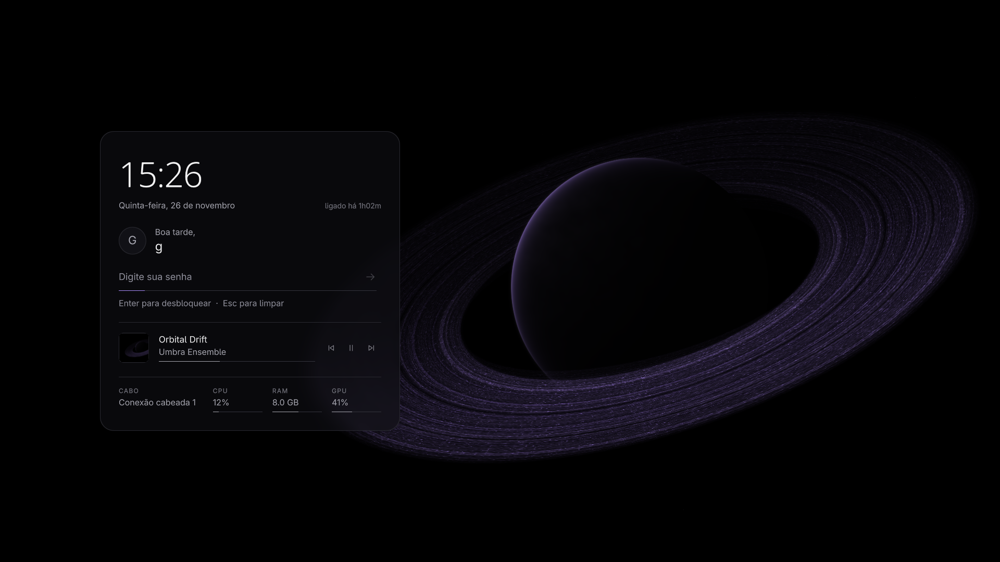

# UMBRA lock screen

Quickshell session lock (`ext-session-lock-v1`) with the greeter's animated
planet and a single frosted panel: clock, greeting, password line, the
player and a row of readings. Lives apart from the greeter; nothing here is
installed by the `nocturne-greeter` package.

```sh
~/Documentos/projetos/umbra/lock/umbra-lock
```



## Emergency exit

If the lock ever stops answering, the screen stays locked: that is the
protocol's point, and the safe state.

1. Press `Ctrl+Alt+F3` and log in on the text console.
2. Run `pkill quickshell`.
3. Go back with `Ctrl+Alt+F2` (or `F1`, wherever Hyprland runs).

Test changes with a second TTY already logged in.

## How it looks and why

- **Background:** `umbra-lock` takes a screenshot with `grim` (only if it
  is installed) just before locking. The lock shows it blurred, desaturated
  and darkened, and the planet is drawn over it: the sphere covers what is
  behind it, while the rings and stars add light. Without `grim`, or if the
  capture or loading fails, the background is the plain black scene with the
  planet.
- **Screenshot handling:** the file is
  `$XDG_RUNTIME_DIR/umbra-lock-<pid>.png` (tmpfs, created with mode 0600).
  The launcher deletes it when Quickshell exits, whether by unlock, a crash
  or `pkill quickshell`, and also deletes leftovers at the next start.
- **Glass panel:** the panel blurs the scene behind it (desktop and planet),
  inside rounded corners with a thin edge. It sits left of the planet, over
  the tip of the rings, so the planet stays the main element.
- **Lilac** appears only on the password line while it has focus, on the
  error and Caps Lock messages, and in the wave across the rings on a wrong
  password. There is no red and no flash.
- **Motion:** idle at ~30 fps (on whole display frames). Typing, PAM and the
  error run at the display rate. `NOCTURNE_REDUCED_MOTION=1` keeps the
  planet still.
- **Text:** pt-BR or English through `Strings` (`NOCTURNE_LANGUAGE`, else
  `LANG`).

## Password line

- Dots, a thin caret and a lilac segment that grows with what is typed,
  instead of jumping to full width.
- While PAM checks, the segment runs the whole line and the message says
  "Verificando…". The dots stay, dimmed.
- A wrong password shakes the dots and fades them, the line rests in grey and
  "Senha incorreta" stays until the next key, while the wave crosses the
  rings.
- Hold the eye to see the password; the arrow submits. `Esc` clears.
- Focus always returns to the password, including after a click on the
  player.

## Readings

Network (Wi-Fi or Ethernet name), Bluetooth (hidden when `bluetoothd` is not
running), CPU, RAM and GPU (GPU only with `nvidia-smi`).
`lock/umbra-lock-stats` takes one sample every 3 s; the slow probes run in
parallel, so a sample takes about 1 s. The player is any MPRIS player,
preferring one that is playing, then Spotify.

## Security

- Locking is `WlSessionLock`; the password goes only to `PamContext`
  (service `login`, same as hyprlock) and is never logged or written.
- There is no shortcut, timeout or escape that unlocks. If Quickshell
  crashes, the compositor keeps the session locked.
- Between pressing the bind and the lock appearing, `grim` adds roughly
  0.1 to 0.3 s before the screen is covered.

## Files

| Path | Role |
| --- | --- |
| `lock.qml` | Entry point: session lock, PAM, readings |
| `lock-preview.qml` | Same surface in an ordinary window (no lock, no PAM) |
| `components/LockSurface.qml` | Backdrop, planet, panel layout and shader clock |
| `components/LockBackdrop.qml` | Blurred screenshot with a safe black fallback |
| `components/LockPasswordField.qml` | Password line, caret, peek, arrow, messages |
| `components/MediaCard.qml`, `StatTile.qml`, `Avatar.qml`, `LockCard.qml` | Panel parts |
| `shaders/pulse-lock.frag.qsb` | The planet shader built with `UMBRA_LOCK` (`lock/build-shader`) |
| `lock/umbra-lock`, `lock/umbra-lock-stats` | Launcher and readings sampler |
| `lock/hyprlock.conf`, `lock/umbra-lock-bg.png` | Static hyprlock fallback |

Quickshell resolves QML only inside the config directory, so `lock.qml`
stays at the repository root and its parts in `components/`.

## Testing

```sh
# Look without locking (an ordinary window; Enter "fails" after 1.2 s)
UMBRA_LOCK_BACKGROUND=/usr/share/hypr/wall1.png quickshell --path lock-preview.qml

# Captures (one state per run): idle | typing | busy | failure | caps
QSG_RENDER_LOOP=basic UMBRA_LOCK_CAPTURE_DIR=/tmp UMBRA_LOCK_CAPTURE_STATE=failure \
  UMBRA_LOCK_WIDTH=2560 UMBRA_LOCK_HEIGHT=1440 quickshell --path lock-preview.qml

# The real lock (keep a TTY logged in, see "Emergency exit")
~/Documentos/projetos/umbra/lock/umbra-lock
```

`grim` is optional: `sudo pacman -S grim` enables the frosted desktop
background.
